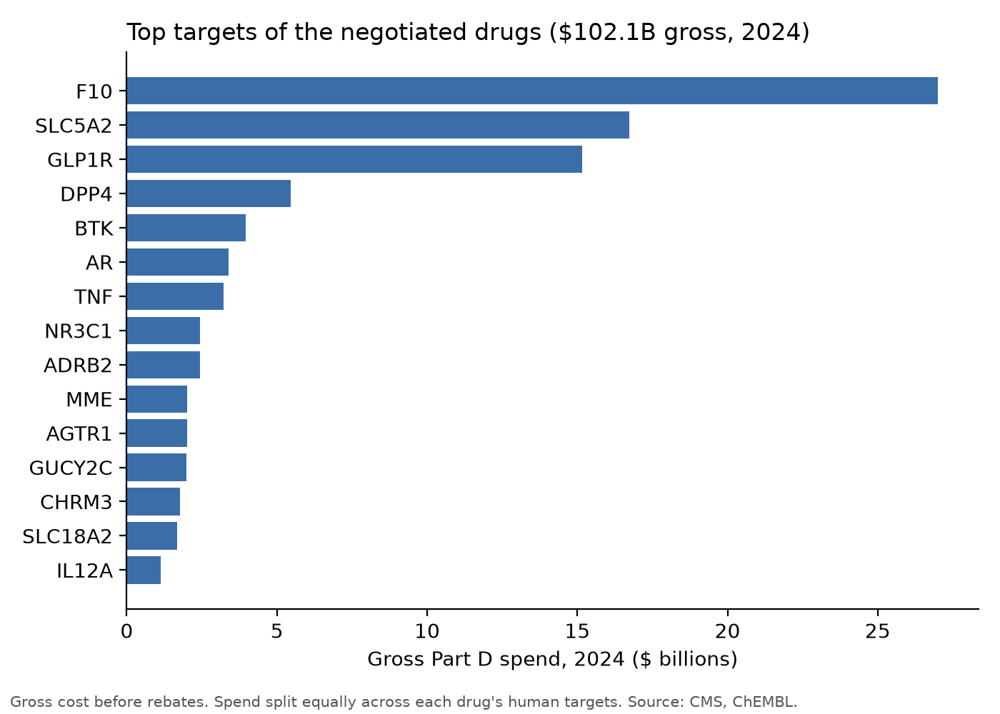
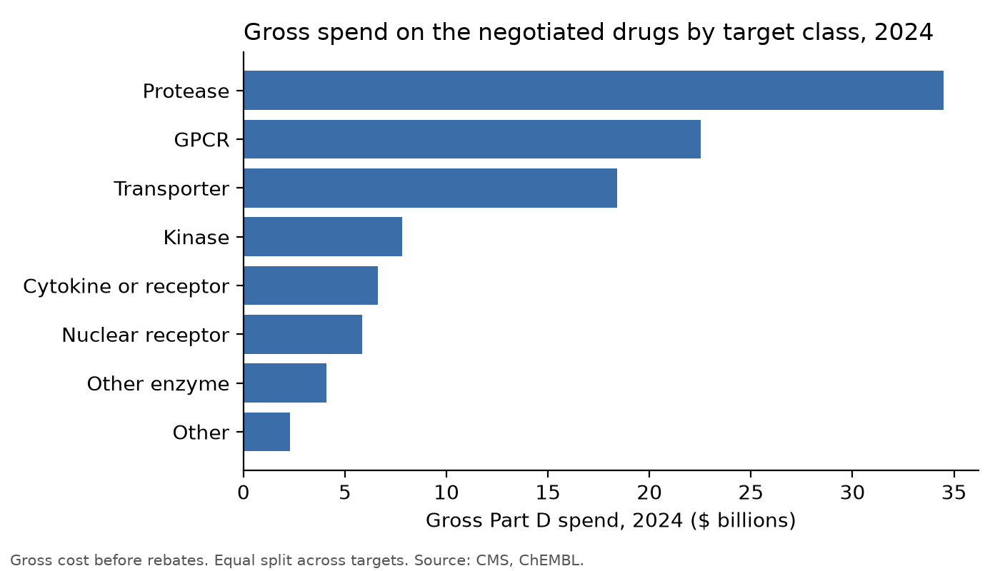
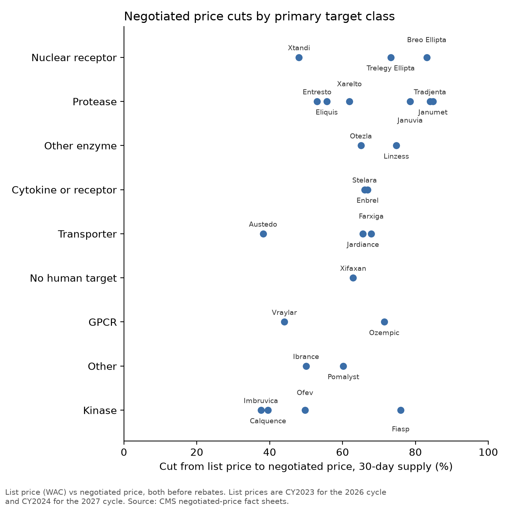
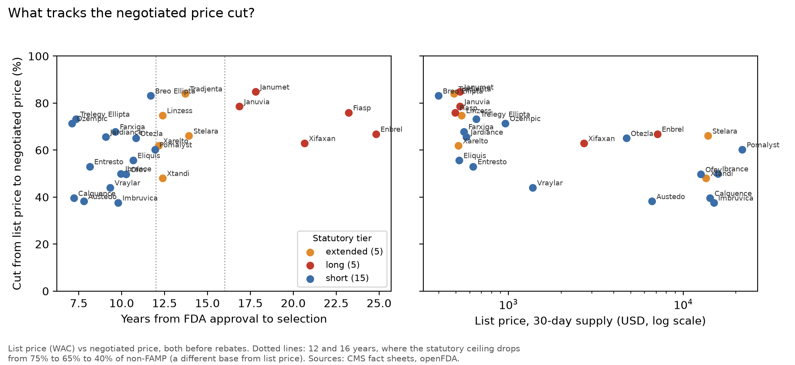
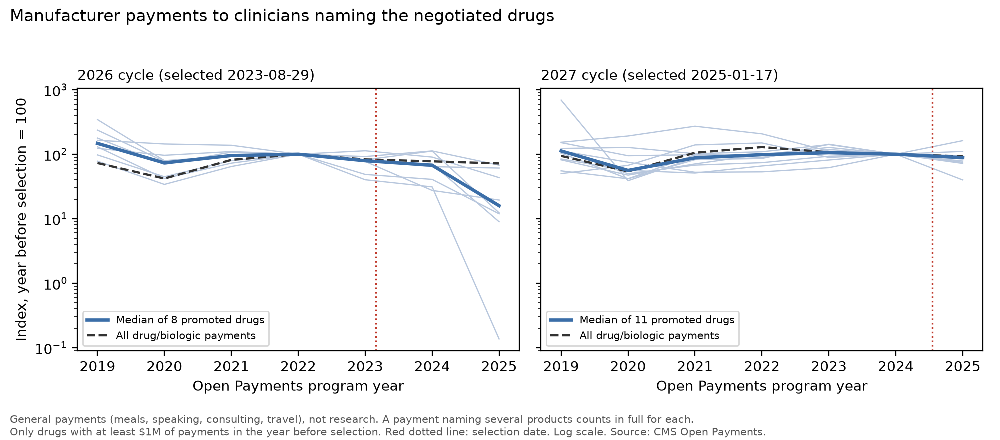

# Genomics Project

This project links the 25 Medicare Part D drugs to the human proteins they act on. It then find which protein targets receive the most gross Part D spend, and if negotiation affected list prices differently between target classes. The project uses data to turn the price list into graphics and data about how gross Part D spend is distributed across the 25 drugs.

## Findings

1. **Three targets make up over half the gross spend.** Out of the $102.1B spent on 24 human-target negotiated drugs from Medicare Part D in 2024, factor Xa (F10; Eliquis, Xarelto) takes 26.5% ($27.0B), SGLT2 (SLC5A2; Farxiga, Jardiance) takes 16.4%, and the GLP-1 receptor (semaglutide) takes 14.9%. The next target, DPP-4, takes 5.4%. By class, proteases take 33.8% of gross spend, GPCRs take 22.1%, and transporters take 18.0%.
2. **Kinase-targeted drugs had the lowest median list price cut, but with a small sample size.** The median difference between list price and negotiated price was 49.7% for the 5 drugs whose primary target is a kinase, 70.2% for proteases (6 drugs), and 73.2% for nuclear receptors (3 drugs). For individual drugs, price cuts ran from 37.6% (Imbruvica, BTK) to 84.8% (Janumet, DPP-4).
3. **Target class and list price level are confounded.** Four of the five kinase drugs are high-list-price specialty drugs (Imbruvica, Calquence, Ofev, Ibrance: $12,622 to $15,741 list price per 30 days) with cuts of 37.6% to 50.0%. The fifth, NovoLog/Fiasp ($495 list price, via the insulin receptor), was cut by 76.0%. But a high list price does not always mean a small cut (Pomalyst, $21,744, cut 60.2%), and some lower-priced drugs had small cuts (Vraylar, $1,376, cut 44.0%). With 1 to 6 drugs per class, the data cannot separate target class from list price level or negotiation cycle.





## Firm and payer findings (extension)

4. **For four firms, most of their gross Part D business is now negotiated.** In 2024, negotiated drugs made up 83.8% of Novo Nordisk's gross Part D spend, 81.0% of Boehringer Ingelheim's, 78.1% of Bristol Myers Squibb's and 77.4% of Merck's. Pfizer (21.7%) and AbbVie (25.3%) were the least exposed of the 14 firms behind the 25 drugs.
5. **List price tracks the cut better than target class does.** Across all 25 drugs, the rank correlation between the cut and the list price is -0.69 (permutation p = 0.0002): cheaper drugs were cut harder. Years on market tracks it too (+0.47, p = 0.018), in the direction the law's price ceiling implies: the median cut was 76.0% for the 5 drugs 16 or more years past FDA approval, 66.1% for the 5 at 12 to 16 years, and 55.7% for the 15 under 12 years. The firm's exposure also tracks it (+0.48, p = 0.016), but these drivers move together, so they are not separate effects.
6. **No clear drop in promotion after selection.** Manufacturer general payments to clinicians naming the selected drugs fell a little faster than all drug payments for the typical drug (median -13.1% against the market for the 2026 cycle, -12.5% for the 2027 cycle). But the 2027 cycle's total rose 15.4% against the market, driven by semaglutide ($19.5M to $31.6M), and the steepest falls for the 2026-cycle drugs came in 2025, the year several of them first faced generic or biosimilar competition, so negotiation and loss of exclusivity cannot be told apart here.




## How the project works

1. **Reference:** 25 negotiated drugs with list price and negotiated price from the two CMS spreadsheets (`data/reference/negotiated_drugs.csv`).
2. **CMS spend:** the Medicare Part D Spending by Drug file, 2020–2024, mapped to one row per drug per year.
3. **Crosswalk:** each ingredient goes through RxNorm and ChEMBL mechanisms to UniProt targets for classification, with fixes (and reasons) in `manual_mappings.csv`; each target gets one of nine classes.
4. **Analysis:** gross spend is attributed to each target, and price cuts are grouped by target classes (`data/processed/`).
5. **Firm track:** CMS manufacturer names are rolled up to 14 parent firms (`data/reference/firm_labelers.csv`, each ownership link sourced); FDA approval dates come from openFDA; Open Payments totals come from the CMS API, server-side (`make payments`).

## Coverage: 

24 of 25 drugs map to a human target, covering 98.88% of 2024 gross spend. Xifaxan (rifaximin) acts only on bacterial RNA polymerase.

## Limits

- **Gross spend doesn't include rebates:** CMS spend is gross, so Medicare's real cost for these drugs is lower than shown.
- **List price vs. negotiated price:** Cuts compare the list price (wholesale acquisition cost) to the negotiated price; both exclude rebates, so the cut is larger than the actual reduction after rebates. List prices are CY2023 for the 2026 cycle and CY2024 for the 2027 cycle.
- **Spend split:** A drug's gross spend is split equally across its human targets. Attributing all of the spend to the first target keeps the top three unchanged, but moves the glucocorticoid receptor (NR3C1) from 8th to 4th and BTK from 5th to 7th.
- **Q1 and Q2 group differently:** Q1 spreads gross spend over every target of a drug, while Q2 puts each drug in the class of its primary target only. So a class can hold many targets in Q1 but few drugs in Q2 (kinases: 13 targets, 5 drugs).
- **Mapping choices:** Metformin (in Janumet) is mapped to one target, GPD2, rather than ChEMBL's ~50 complex I subunits; its mechanism is contested. Classes follow ChEMBL's protein classification, so the insulin receptor counts as a kinase.
- **Scope:** Results cover the 25 negotiated drugs and don't generalize to all of Part D.
- **Firm exposure is by CMS labeler:** firm totals include only the mapped labeler names, so they are lower bounds and shares are upper bounds. Joint ventures and spin-offs are left out (ViiV, $2.50B, is not counted for GSK). Co-marketed drugs (Eliquis with Pfizer, Xtandi with Pfizer, Imbruvica with J&J) count only for the labeler CMS lists.
- **Cut drivers are correlations, n = 25:** years on market is measured to the CMS selection date, and the statutory ceiling applies to non-FAMP, not to list price, so it is not a hard floor on the cuts shown here.
- **Open Payments:** a payment naming several products counts in full for each; names are matched by exact spelling, so totals are lower bounds; six drugs with under $1M of payments before selection are left out of the promoted-drug figures.

## Reproduction

```bash
make setup && make ingest && make map && make payments && make analyze
```

`make gate2` checks every table, the figures and this README. Progress, checks and open doubts are in `docs/status.md`; method decisions are in `docs/decisions.md`.

## Data sources

- CMS [Medicare Part D Spending by Drug](https://data.cms.gov/summary-statistics-on-use-and-payments/medicare-medicaid-spending-by-drug/medicare-part-d-spending-by-drug)
- CMS negotiated price fact sheets: [2026 cycle](https://www.cms.gov/files/document/fact-sheet-negotiated-prices-initial-price-applicability-year-2026.pdf), [2027 cycle](https://www.cms.gov/files/document/fact-sheet-negotiated-prices-ipay-2027.pdf)
- [RxNorm](https://lhncbc.nlm.nih.gov/RxNav/) (NLM), [ChEMBL](https://www.ebi.ac.uk/chembl/) (EMBL-EBI), [UniProt](https://www.uniprot.org/)
- CMS selected drug fact sheets: [2026 cycle](https://www.cms.gov/files/document/fact-sheet-medicare-selected-drug-negotiation-list-ipay-2026.pdf), [2027 cycle](https://www.cms.gov/files/document/factsheet-medicare-negotiation-selected-drug-list-ipay-2027.pdf); price ceiling tiers from [42 U.S.C. 1320f-3](https://www.law.cornell.edu/uscode/text/42/1320f-3)
- FDA approval dates from [openFDA drugsfda](https://open.fda.gov/apis/drug/drugsfda/); manufacturer payments from [CMS Open Payments](https://openpaymentsdata.cms.gov/)
